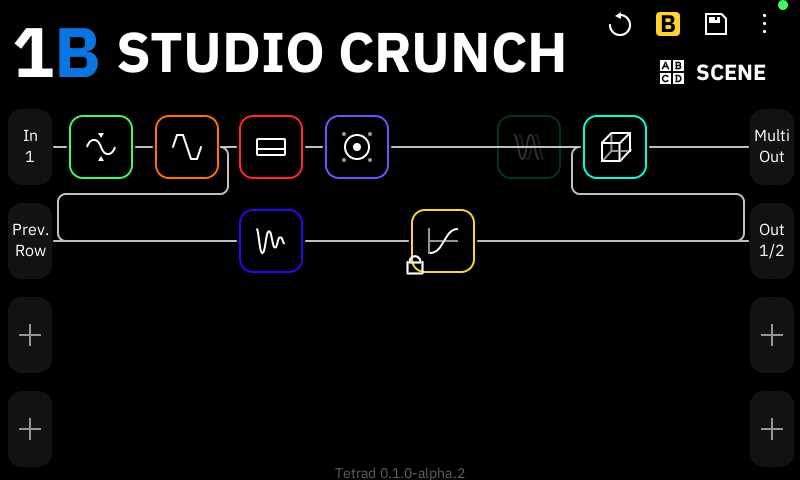
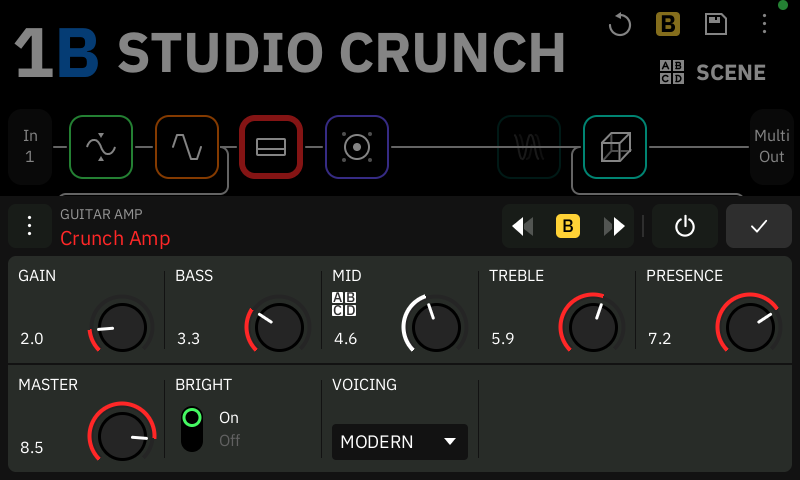
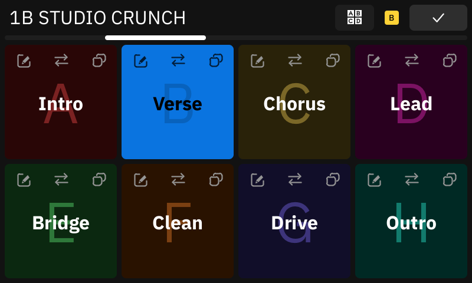
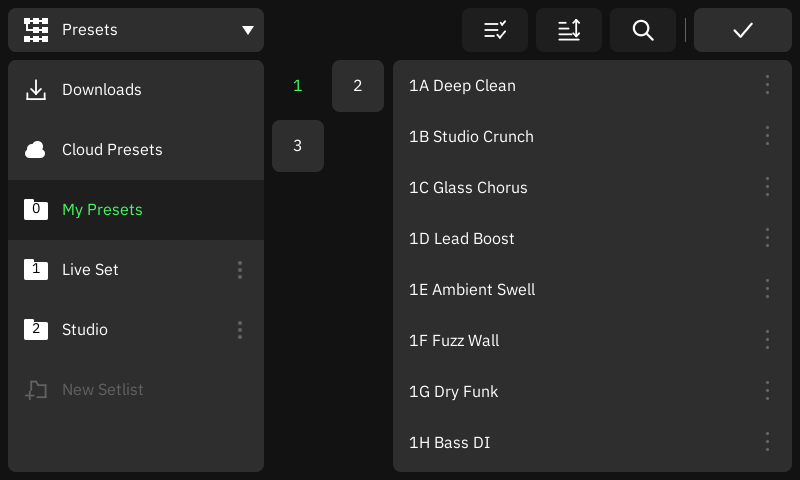
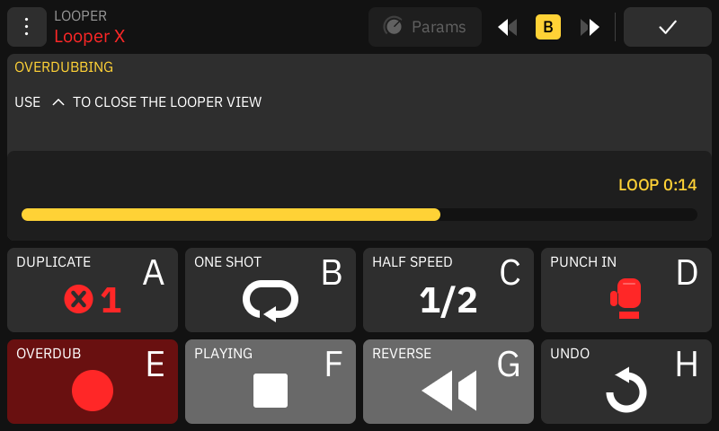
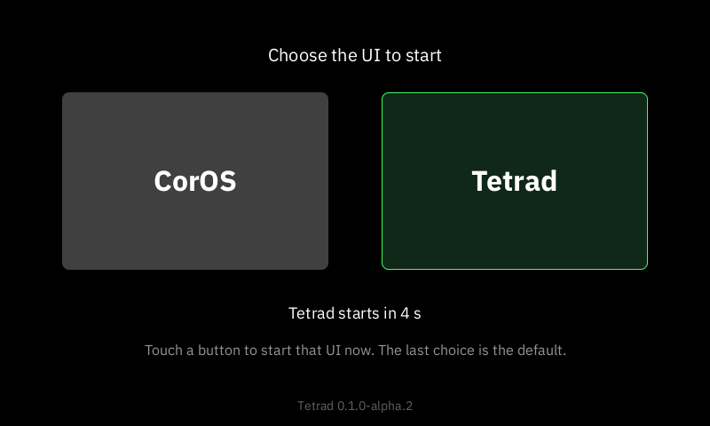

<h1 align="center">Tetrad</h1>

<p align="center">An open, community-built touch UI for the Neural DSP Quad Cortex.</p>

<p align="center">
  <a href="https://github.com/JudahZF/tetrad/releases"></a>
  
  <a href="LICENSE"></a>
</p>

<p align="center">
  
</p>

Tetrad replaces the touch UI of your Quad Cortex with a new one, written from scratch in Rust.
The stock UI program (ZenUI) stays installed. Tetrad keeps the stock Linux kernel, drivers,
bootloader and DSP firmware, and it reads the stock data files from your own unit at run time.
Your presets sound the same. At every boot you choose Tetrad or stock CorOS.

> [!WARNING]
> Tetrad is alpha software. It is not made, endorsed or supported by Neural DSP Technologies. To
> install it you need root SSH access to your unit. Read [Before you install](#before-you-install)
> first.

## What it looks like

<table>
  <tr>
    <td width="50%"><br>Edit each block with the screen or the knobs.</td>
    <td width="50%"><br>Gig view: large scene buttons for the stage.</td>
  </tr>
  <tr>
    <td width="50%"><br>Presets, setlists, downloads and cloud presets.</td>
    <td width="50%"><br>The Looper, with overdub, reverse and half speed.</td>
  </tr>
</table>

## What works

- **Your sound, unchanged.** Tetrad starts the stock DSP firmware and loads presets as stock
  does. It has a driver for every stock model except the Looper block.
- **The touch UI.** The Grid, Gig and Stomp views, the preset and capture browsers, the
  block editors, settings, dialogs and keypads, in the stock look.
- **Play live.** Footswitches, stomp and scene modes, scene copy, bank changes, expression
  pedals, tempo and tap tempo, the tuner, the metronome and the Looper.
- **MIDI.** DIN and USB MIDI in and out, program changes, MIDI clock and Preset MIDI Out.
- **Mappings.** One page (⋮ → Mappings) for what footswitches, pedals, MIDI messages and
  extensions do: scenes, presets, tuner, tap tempo, Looper, block bypass and parameters, and
  Send MIDI. See [docs/mappings.md](docs/mappings.md).
- **Themes.** Choose the colours of the UI in Settings → System → Appearance: Stock, Stage
  High Contrast, Slate, Ember, or your own theme files and extension themes. See
  [docs/themes.md](docs/themes.md).
- **Extensions.** Install small TypeScript programs from signed GitHub repositories
  (Settings → System → Extensions), such as MIDI Mapper for a second MIDI channel. See
  [docs/extensions.md](docs/extensions.md).
- **Cortex Control.** Connect the desktop app over USB to change settings and the Global EQ,
  browse files, make backups and update CorOS.
- **Wi-Fi and cloud.** Sign in, download and upload presets, and back up to the cloud or to the
  unit.
- **Tetrad updates.** Update Tetrad from the touchscreen (Settings → System → Tetrad Updates).
  CorOS does not change. See [docs/updates.md](docs/updates.md#tetrad-updates).
- **CorOS updates.** Update CorOS from the touchscreen (Settings → System → CorOS Updates). Tetrad
  stays installed. See [docs/updates.md](docs/updates.md).
- **Neural Capture.** The capture screens and steps are there. Capture training on the unit is
  not tested.

Tested on one original Quad Cortex with CorOS 4.1.0 and 4.1.1, including a 61 minute session
with Cortex Control. See [Known gaps](#known-gaps) for what is not tested.

## Install

1. **Check your unit.** You need an original Quad Cortex with CorOS 4.1.0 or 4.1.1, and root
   SSH access to it. Tetrad does not give you this access.
2. **Download and install.** Download `tetrad-<version>-armv7.tar.gz` from
   [Releases](https://github.com/JudahZF/tetrad/releases) and unpack it. In its folder, run:

   ```sh
   scripts/install.sh --host qc install
   ```

   `qc` is the SSH host of your unit (see [Set up SSH](docs/install.md#2-set-up-ssh)).
3. **Restart and choose.** Touch **Tetrad** on the boot screen.

The full guide is [docs/install.md](docs/install.md). It also tells you how to update, turn off
and remove Tetrad. A unit with zen-rs (the old working name of Tetrad): see
[Migrating from zen-rs](docs/install.md#migrating-from-zen-rs).

## Go back to CorOS at any time

<table>
  <tr>
    <td width="50%"></td>
    <td>At every boot this screen shows for 5 seconds. Touch <b>CorOS</b> to start the stock UI.
    Without a touch, your last choice starts. If Tetrad fails to start three times in a row, the
    unit starts CorOS by itself.</td>
  </tr>
</table>

Each of these steps puts stock CorOS back. Use the first one that works.

1. **Pick CorOS on the boot selector.** Touch "CorOS" during the 5 second countdown. Tetrad
   saves the choice, so the next boots also start CorOS.
2. **Disarm over SSH.** Run `sh /media/p4/tetrad/launcher/tetrad-launcher.sh disarm` on the unit
   and restart it. The hook stays, but it starts stock ZenUI.
3. **Let the start counter act.** When Tetrad fails before its start-up ends three times in a
   row, the next boot starts stock and stays stock. A power cut during the start-up also counts.
4. **Remove the hook.** Run `tetrad-launcher.sh disarm`, then `tetrad-launcher.sh remove-hook`. The
   init script is then the CorOS original again.
5. **Use the SD card.** On a computer, open partition 4 (ext4) and delete
   `tetrad/launcher/select`. The hook then starts stock ZenUI.
6. **Roll back a CorOS update.** The unit keeps the previous CorOS on the other root partition.
   The boot partition (p3) holds one empty file, `one` or `two`, that selects the root
   partition. Change that file to the other name and restart. This step is not tested on a unit.
   See [docs/updates.md](docs/updates.md#roll-back).

Details: [docs/launcher.md](docs/launcher.md#recovery).

## Before you install

- **It changes the boot.** The installer changes one line in `/etc/init.d/S80drvinit` on the
  unit. Removing the hook puts back the original file byte for byte.
- **You need root SSH access** to the unit. Tetrad does not give you this access.
- **It can void your warranty.** Neural DSP does not support modified units.
- **It is alpha software.** A bug can stop audio, lose a setting or need a recovery from the SD
  card. Keep a full backup of the SD card.
- **No stock files are included.** Tetrad reads the stock firmware files, data and device keys
  from your unit at run time. This repository contains no Neural DSP code, firmware, assets or
  keys.
- **A bad CorOS update needs manual steps.** No automatic fall-back is known if a CorOS update
  writes a bad root partition. Only step 6 of the recovery steps above brings the unit back.

## Known gaps

- Only one unit type is tested: the original Quad Cortex without the ESS codec. The ESS codec
  and the Quad Cortex mini paths exist in code but have no hardware test.
- Only CorOS 4.1.0 and 4.1.1 are supported. On another build Tetrad starts stock CorOS.
- Not tested on the unit: Neural Capture training, loading a user Neural Capture 2 capture,
  capture over Cortex Control, the Global EQ and limiter toggles with audio, DIN MIDI, the panel
  controls one by one, cable pulls and shutdown.
- Support reports are off: SEND REPORT and the Cortex Control log request are refused.
- Cortex Control gain calibration is refused, because stock writes the U-Boot environment there.
- Tetrad writes only the stock library database schema of CorOS 4.1.x (410.1).
- The boot selector has no settings page. Use `tetrad-launcher.sh chooser on|off`.
- Mappings cannot yet load a chosen preset, set a tempo value, send MIDI from a MIDI trigger
  or a global mapping, or run system actions from an expression pedal.

The changes in each release are in [CHANGELOG.md](CHANGELOG.md).

## Contribute

To build Tetrad, run the tests or find your way in the code, see
[docs/development.md](docs/development.md).

## Licence

Tetrad is licensed under the GNU General Public License v3.0 or later. See [LICENSE](LICENSE).

The IBM Plex Sans fonts in `crates/tetrad-assets/fonts/ibm-plex-sans/` keep their own licence, the
SIL Open Font License 1.1. See `OFL.txt` in that folder.

Tetrad is an independent, unofficial project. It is not affiliated with, endorsed by or
supported by Neural DSP Technologies. "Neural DSP", "Quad Cortex", "CorOS" and "Cortex Control"
are trademarks of their owners.
