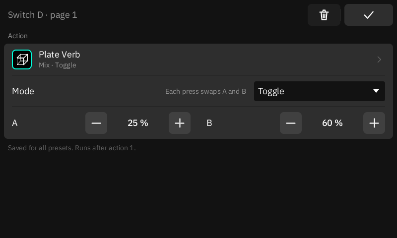
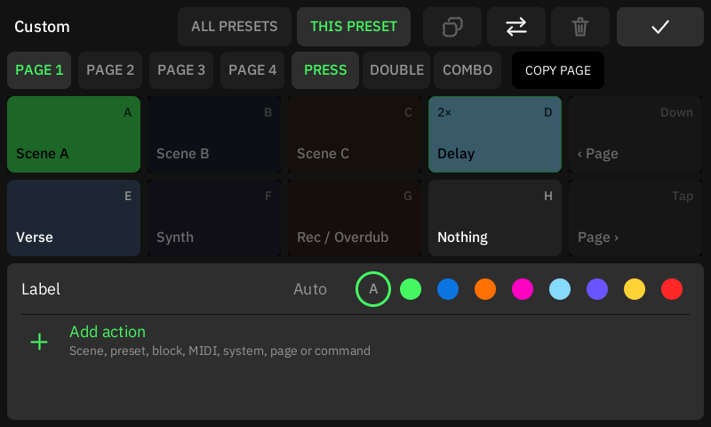

# Custom footswitch mode

Tetrad's **Custom** mode takes the place of stock Stomp mode, next to Preset and Scene. The
mode has four pages. On each page, ten footswitches are yours: A, B, C, D and Down on the top
row, and E, F, G, H and Tap on the bottom row. Each footswitch runs up to eight actions that
you choose, such as a scene, a preset, a block, MIDI, a system action, a page change or a
command of an extension. Each action has a mode, as on the [Mappings](mappings.md#modes) page.

Page 1 of each preset plays the preset's Stomp-mode assignments on A–H, so your presets work as
they did in Stomp mode ([Stomp-mode data on page 1](#stomp-mode-data-on-page-1)).

- [Turn it on](#turn-it-on)
- [Choose the actions](#choose-the-actions)
- [Copy and move switches](#copy-and-move-switches)
- [Switches for one preset](#switches-for-one-preset)
- [Stomp-mode data on page 1](#stomp-mode-data-on-page-1)
- [Bank Up and the other switches](#bank-up-and-the-other-switches)
- [Control it with MIDI](#control-it-with-midi)
- [Where it is saved](#where-it-is-saved)

## Turn it on

Go to the next mode until the mode button shows **CUSTOM**: tap the mode button of the Grid or
Gig View, or press **Down** and **Tap** together. The cycle is Preset → Scene → Custom → Preset
(Settings › Modes changes it, as in stock). In the Custom mode, **Bank Up** goes to the next
mode.

The unit stores the mode as Stomp mode, so stock CorOS and Cortex Control show Stomp mode. The
mode starts on page 1. Tetrad has no hybrid mode with Custom: a unit that had a Stomp hybrid
(such as Scene over Stomp) plays the Custom mode instead. Hybrids of Preset and Scene stay.

You do not need the Custom Footswitch Mode extension of Tetrad 0.1.0-alpha.10 and earlier. Its
switches move to Tetrad the first time Tetrad starts, and you can remove the extension.

## Choose the actions

Open the editor with **EDIT** in Gig View, or with the **Footswitches** row of the
[Mappings](mappings.md) page.

  

1. Tap a page tab (**PAGE 1** to **PAGE 4**).
2. Tap a switch. Its label, colour and actions show below the switches. Scroll the actions to
   see more.
3. Tap **Add action**, or an action to change it. The action editor opens: it has the
   **Action**, **Mode** and **Values** rows of a mapping (see [mappings.md](mappings.md#modes)).
4. Tap the **Action** row and choose the action:

   | Action | What a press does |
   | --- | --- |
   | Preset → Next or Previous | Loads the next or previous preset. |
   | Preset → Load *name* | Loads the preset that is loaded now. If you move the preset to another slot, the switch finds it there. |
   | Preset → Choose a preset | Loads a preset that you choose: tap a setlist, then a preset. If you move the preset to another slot, the switch finds it there. |
   | Scene | Selects a scene, or the next or previous scene. A scene with a name in the loaded preset shows that name, with **Scene A** under it. |
   | Tuner, Gig View | Opens or closes it. |
   | Tempo → Tap tempo | A tap tempo. |
   | Mode | Goes to another footswitch mode. |
   | Looper | A Looper button: a tap, or (**Momentary**) held while the switch is held. |
   | Page | The next page, the previous page or page 1 to 4. The pages wrap. |
   | BLOCKS → a block → Bypass | Turns the block on or off: **Toggle**, **Momentary** (only while the switch is down) or **Set** (always on, or always off). |
   | BLOCKS → a block → a parameter | **Set** a value, **Toggle** between A and B, **Momentary** (the value while the switch is down) or **Step** (move the value on each press). Values show in the parameter's own units. |
   | MIDI OUT → Send MIDI | Sends up to 12 messages (CC, CC Toggle or PC). Tap **Edit messages**. |
   | EXTENSIONS → Commands | Runs a command of a running extension. |

5. **Mode**: how the press drives the action, as on the Mappings page. A block bypass, the Tuner
   and Gig View have Toggle, Momentary and Set. A parameter has Set, Toggle, Momentary and Step.
   A Looper button has On press and Momentary. The other actions run on each press.
6. The trash button of the action editor removes the action. Back returns to the switches.
7. **Label**: the text of the switch in Gig View. Leave it empty to show the name of the first
   action.
8. **Colour**: the colour of the switch LED and its Gig View tile. **A** (Auto) takes a colour
   from the first action, such as the scene colour or the block colour.
9. The trash button above the switches clears the switch.

A press runs the actions in their order. A release ends the Momentary actions. The tile, the
LED and Gig View show the first action.

  

### Double press and combos

A switch can do a second action when you press it two times, and two switches next to each
other can do a third action when you press them together. **PRESS**, **DOUBLE** and **COMBO**
(right of the page tabs) choose which action of the selected switch the editor shows. Set it
as you set the press: its actions and its label. The colour belongs to the switch.

- **DOUBLE**: runs when you press the switch two times within the double press time (300 ms
  unless you change it). Its press does not run. The tile shows **2×**.
- **COMBO**: runs when you press two adjacent switches within the combo time of each other
  (80 ms unless you change it): side by side
  in a row (such as C and D, or D and Down) or one above the other (such as D and H). Their
  presses do not run. In COMBO, tap a bright tile to choose the other switch. A **+** between two
  tiles shows a combo.

A switch with a double press waits up to the double press time before its press runs, so that
a second press can come. A switch in a combo waits up to the combo time. A switch with neither
runs at once, as before.

To change the times, open Settings → Device → **Double Press & Combo**. Double Press is 200,
250, 300, 400 or 500 ms; Combo is 50, 80, 120 or 160 ms. A longer time is easier to hit, and a
shorter one makes the press of the switch come sooner.
When you hold a switch that waits, its press runs at the end of the wait and stays on until you
release the switch, so Momentary still works.

Only the footswitches do double presses and combos. MIDI CC#35 to 42 press the switches too: two
messages for one switch within the double press time are a double press. They cannot make a
combo, because each message presses and releases its switch at once. A Gig View tap and the
**Press** actions of Mappings run the press at once. A page change drops a press that waits.

The trash button clears the action that shows. In PRESS, it clears the whole switch, its double
press too. COPY and MOVE take the whole switch (its press, double press and colour); combos
stay where they are. COPY PAGE copies the combos of the page too.

### Copy and move switches

- **COPY** (the two squares): tap it, then tap another switch. That switch gets a copy of the
  selected one: its actions, label and colour.
- **MOVE** (the two arrows): tap it, then tap another switch. The two switches swap.
- **COPY PAGE**: tap it, then tap a page tab. That page gets a copy of the page that shows.

To put a switch on another page, tap COPY or MOVE, then the page tab, then the switch. Tap the
button again, or ✓, to cancel.

### Switches for one preset

The **ALL PRESETS** layout plays in every preset. **THIS PRESET** holds the loaded preset's own
switches, and they play instead, switch by switch:

- A switch of THIS PRESET with actions plays them. A switch without actions plays the ALL
  PRESETS switch. The editor shows that one dimmed.
- To make a switch play nothing in this preset, give it the **Nothing** action (THIS PRESET in
  the action menu).
- The same rule applies to a double press and to a combo.

Save the preset to keep its switches, as for any other edit of the preset. Stock CorOS ignores
them and keeps them when it saves the preset.

  

A block action is for the block in that grid position, in each preset. If a preset has no block
there, the switch does nothing in that preset. A parameter action also needs the same block
model as when you chose it.

### Stomp-mode data on page 1

Switches A–H on page 1 of THIS PRESET show the preset's Stomp-mode data, which stock CorOS
reads:

- each block that the switch toggles in Stomp mode, as a bypass action: **Toggle**, or
  **Momentary** when the switch is momentary in Stomp mode;
- the switch's Preset MIDI Out list, as a **Send MIDI** action;
- the switch's Stomp label, as its label.

A press of the switch runs them as stock Stomp mode does (with the secondary block toggles and
the Scene Bypass Behaviour). An edit goes back to the stock data, so stock CorOS and Cortex
Control see it:

- A bypass action in Toggle or Momentary on A–H of page 1 assigns its block to the switch.
  Stock has one Toggle or Momentary for each switch: the bypasses in the mode of the first one
  are stock data, and a bypass in the other mode is Tetrad data. A block can be on one of these
  switches only: for a second switch, use **Set**.
- **Nothing** on one of these switches stops its Stomp-mode data too.
- A bypass in **Set** mode, a second Send MIDI and every other action are Tetrad data.
- **Assign footswitch** in the block editor still assigns a block to a switch.

The footswitch mappings of Tetrad 0.1.0-alpha.10 and earlier (a footswitch trigger on the
Mappings page) show here too, after the Stomp-mode data. The next edit of the preset's switches
moves them from the Mappings data to the preset's switches.

### LEDs and Gig View

Gig View shows the ten switches of the current page, the page number and **EDIT**. Tap a tile to
press its switch. Tap the page number to go to the next page.

The LED of a switch is at full brightness when its first action is on: its scene is the active scene,
its block is on, the tuner or Gig View shows, or the switch is held. It is dimmed when the
action is off, and off when the switch has no action. Bank Up is dimmed white.

## Bank Up and the other switches

- **Bank Up** belongs to Tetrad in the Custom mode. A short press goes to the next mode. A long
  press opens the tuner. While the tuner or the tempo page shows, Bank Up closes it.
- **Down** and **Tap** are switches of the mode. The Down + Tap mode chord, tap tempo on Tap and
  the tuner on a Tap hold do not work in the Custom mode. Use a switch action, the screen or
  Bank Up for them.
- A switch that you hold while the page changes stays on its action: its release ends what its
  press started. When the mode ends, Tetrad releases the switches that are held.
- MIDI CC#35 to 42 press switches A to H of the current page, as in the other modes.

## Control it with MIDI

Use the [Mappings](mappings.md) page. A MIDI CC or note, or a MIDI Mapper trigger, can run these
SYSTEM actions:

- **Mode → Custom mode**: turns the Custom mode on.
- **Custom** (the mode's name) → **Next page**, **Previous page**, **Page 1** to **Page 4**.
- **Custom** → **Press A** to **Press Tap**: presses that switch of the current page, as a
  Looper button works in Mappings. **On press** taps the switch (a press, then a release).
  **Momentary** holds it from the press to the release: a note-off, a CC that leaves its window
  or the release of a MIDI Mapper key. Use Momentary for a switch with Momentary actions.

These actions do nothing while the Custom mode is off.

## Where it is saved

- The ALL PRESETS switches: `/media/p4/tetrad/footswitch-layout.json`. When the file is missing,
  Tetrad reads the switches of the Custom Footswitch Mode extension of Tetrad 0.1.0-alpha.10
  and earlier (`/media/p4/tetrad/footswitch-modes/`) once and writes them there.
- The switches of one preset: in the preset (a Tetrad field that stock CorOS keeps), with the
  Stomp-mode data in the stock fields.
- A layout from Tetrad 0.1.0-alpha.10 or earlier (one action per switch) reads as before: a
  parameter's value becomes Set, a momentary bypass and a Looper button become Momentary. Tetrad
  writes it in the new format, which older Tetrad builds do not read.
- The double press and combo times: `/media/p4/tetrad/footswitch-mode.json`.
- The mode: the stock footswitch mode setting (Stomp).
