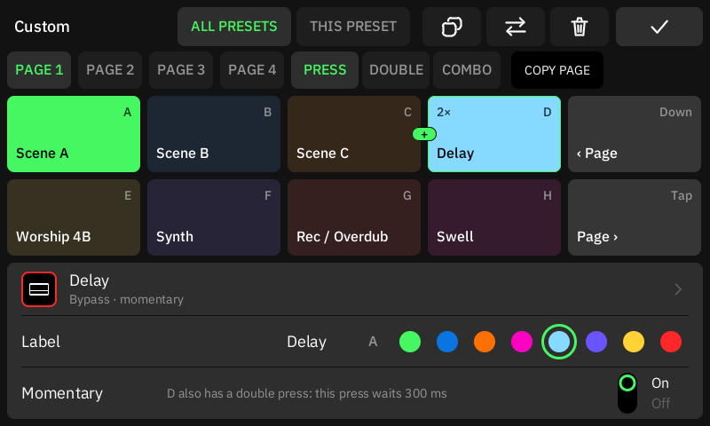

# Custom footswitch mode

The **Custom Footswitch Mode** extension adds a fourth footswitch mode next to Preset, Scene and
Stomp. The mode has four pages. On each page, ten footswitches are yours: A, B, C, D and Down
on the top row, and E, F, G, H and Tap on the bottom row. Each footswitch runs one action that
you choose, such as a scene, a preset, a block, MIDI, a system action, a page change or a
command of another extension.

Tetrad runs the mode itself. The extension only adds it, so it runs no code, and a footswitch
press never waits for an extension.

- [Turn it on](#turn-it-on)
- [Choose the actions](#choose-the-actions)
- [Copy and move switches](#copy-and-move-switches)
- [A layout for one preset](#a-layout-for-one-preset)
- [Bank Up and the other switches](#bank-up-and-the-other-switches)
- [Control it with MIDI](#control-it-with-midi)
- [Where it is saved](#where-it-is-saved)
- [Add a footswitch mode to your extension](#add-a-footswitch-mode-to-your-extension)

## Turn it on

1. Install **Custom Footswitch Mode** (Settings → Tetrad → Extensions, see
   [extensions.md](extensions.md#install)).
2. Go to the next mode until the mode button shows **CUSTOM**: tap the mode button of the Grid
   or Gig View, or press **Down** and **Tap** together. The mode comes after the stock modes in
   the cycle: Preset → Scene → Stomp → Custom → Preset. In the Custom mode, **Bank Up** goes to
   the next mode.

The mode starts on page 1. When you restart the unit in the Custom mode, it comes back in the
Custom mode.

## Choose the actions

Open the editor with **EDIT** in Gig View, or with **EDIT** under "Footswitch mode" on the
extension's page.

<p align="center">
  
</p>

1. Tap a page tab (**PAGE 1** to **PAGE 4**).
2. Tap a switch. Its settings show below the switches.
3. Tap the **Action** row and choose the action:

   | Action | What a press does |
   | --- | --- |
   | Preset → Next or Previous | Loads the next or previous preset. |
   | Preset → Load *name* | Loads the preset that is loaded now. If you move the preset to another slot, the switch finds it there. |
   | Preset → Choose a preset | Loads a preset that you choose: tap a setlist, then a preset. If you move the preset to another slot, the switch finds it there. |
   | Scene | Selects a scene, or the next or previous scene. |
   | Tuner, Gig View | Opens or closes it. |
   | Tempo → Tap tempo | A tap tempo. |
   | Mode | Goes to another footswitch mode. |
   | Looper | A Looper button. It is held while the switch is held. |
   | Page | The next page, the previous page or page 1 to 4. The pages wrap. |
   | BLOCKS → a block → Bypass | Turns the block on or off. With **Momentary** on, the block changes only while the switch is down. |
   | BLOCKS → a block → a parameter | Sets the parameter to **Value** (5 % steps). |
   | MIDI OUT → Send MIDI | Sends up to 12 messages (CC, CC Toggle or PC). Tap **Edit messages**. |
   | EXTENSIONS → Commands | Runs a command of a running extension. |

4. **Label**: the text of the switch in Gig View. Leave it empty to show the name of the action.
5. **Colour**: the colour of the switch LED and its Gig View tile. **A** (Auto) takes a colour
   from the action, such as the scene colour or the block colour.
6. The trash button clears the switch.

### Double press and combos

A switch can do a second action when you press it two times, and two switches next to each
other can do a third action when you press them together. **PRESS**, **DOUBLE** and **COMBO**
(right of the page tabs) choose which action of the selected switch the editor shows. Set it
as you set the press: Action, Label and the action's setting. The colour belongs to the switch.

- **DOUBLE**: runs when you press the switch two times within 300 ms. Its press does not run.
  The tile shows **2×**.
- **COMBO**: runs when you press two adjacent switches within 80 ms of each other: side by side
  in a row (such as C and D, or D and Down) or one above the other (such as D and H). Their
  presses do not run. In COMBO, tap a bright tile to choose the other switch. A **+** between two
  tiles shows a combo.

A switch with a double press waits up to 300 ms before its press runs, so that a second press
can come. A switch in a combo waits up to 80 ms. A switch with neither runs at once, as before.
When you hold a switch that waits, its press runs at the end of the wait and stays on until you
release the switch, so Momentary still works.

Only the footswitches do double presses and combos, and MIDI CC#35 to 42, which press them. A
Gig View tap and the **Press** actions of Mappings run the press at once. A page change drops a
press that waits.

The trash button clears the action that shows. In PRESS, it clears the whole switch, its double
press too. COPY and MOVE take the whole switch (its press, double press and colour); combos
stay where they are. COPY PAGE copies the combos of the page too.

### Copy and move switches

- **COPY** (the two squares): tap it, then tap another switch. That switch gets a copy of the
  selected one: its action, label, colour and settings.
- **MOVE** (the two arrows): tap it, then tap another switch. The two switches swap.
- **COPY PAGE**: tap it, then tap a page tab. That page gets a copy of the page that shows.

To put a switch on another page, tap COPY or MOVE, then the page tab, then the switch. Tap the
button again, or ✓, to cancel.

### A layout for one preset

The **ALL PRESETS** layout plays in every preset. A preset can have its own layout instead:

1. Load the preset and open the editor.
2. Tap **THIS PRESET**, then **GIVE IT ITS OWN LAYOUT**. The preset gets a copy of the ALL
   PRESETS layout.
3. Change the switches as for ALL PRESETS.
4. Save the preset to keep its layout, as for any other edit of the preset.

While that preset is loaded, its own layout plays. **REMOVE** (in THIS PRESET) deletes it, and
the preset plays the ALL PRESETS layout again. Stock CorOS ignores the layout and keeps it when it
saves the preset.

A block action is for the block in that grid position, in each preset. If a preset has no block
there, the switch does nothing in that preset. A parameter action also needs the same block
model as when you chose it.

### LEDs and Gig View

Gig View shows the ten switches of the current page, the page number and **EDIT**. Tap a tile to
press its switch. Tap the page number to go to the next page.

The LED of a switch is at full brightness when its action is on: its scene is the active scene,
its block is on, the tuner or Gig View shows, or the switch is held. It is dimmed when the
action is off, and off when the switch has no action. Bank Up is dimmed white.

## Bank Up and the other switches

- **Bank Up** belongs to Tetrad in the Custom mode. A short press goes to the next mode. A long
  press opens the tuner. While the tuner or the tempo page shows, Bank Up closes it.
- **Down** and **Tap** are switches of the mode. The Down + Tap mode chord, tap tempo on Tap and
  the tuner on a Tap hold do not work in the Custom mode. Use a switch action, the screen or
  Bank Up for them.
- A switch that you hold while the page changes stays on its action: its release ends what its
  press started. When the mode ends, Tetrad releases the switches that are held.
- MIDI CC#35 to 42 press switches A to H of the current page, as in the other modes.

## Control it with MIDI

Use the [Mappings](mappings.md) page. A MIDI CC or note, or a MIDI Mapper trigger, can run these
SYSTEM actions:

- **Mode → Custom mode**: turns the Custom mode on.
- **Custom** (the mode's name) → **Next page**, **Previous page**, **Page 1** to **Page 4**.
- **Custom** → **Press A** to **Press Tap**: presses that switch of the current page, as a
  Looper button works in Mappings. **On press** taps the switch (a press, then a release).
  **Momentary** holds it from the press to the release: a note-off, a CC that leaves its window
  or the release of a MIDI Mapper key. Use Momentary for a switch with a momentary action.

These actions do nothing while the Custom mode is off.

## Where it is saved

- The ALL PRESETS switches: `/media/p4/tetrad/footswitch-modes/<repository>~<extension>.json`.
  When you remove the extension, the file stays, so a new install keeps your switches.
- The layout of one preset: in the preset (a Tetrad field that stock CorOS keeps).
- Whether the mode is on: `/media/p4/tetrad/footswitch-mode.json`.

Stock CorOS does not read these files. Cortex Control and MIDI CC#47 see the stock mode under
the Custom mode.

## Add a footswitch mode to your extension

An extension with manifest API 4 can add a footswitch mode:

```json
{
  "id": "my.footswitches",
  "name": "My Footswitches",
  "version": "0.1.0",
  "api": 4,
  "footswitchMode": { "name": "Custom", "pages": 4 }
}
```

- `name`: 1 to 16 characters. The mode button shows it in capitals.
- `pages`: 1 to 4.

A manifest with only a footswitch mode is data only: it needs no `src/` and no build, and
`tetrad-ext package` packs it without a module. An extension with code can add a mode too, and
its commands can be switch actions.

Only one footswitch mode can be on. When two enabled extensions add one, the mode of the first
by its install key is used, and the page of the other says so. Tetrad builds before API 4 do not
show the package in the catalog.
