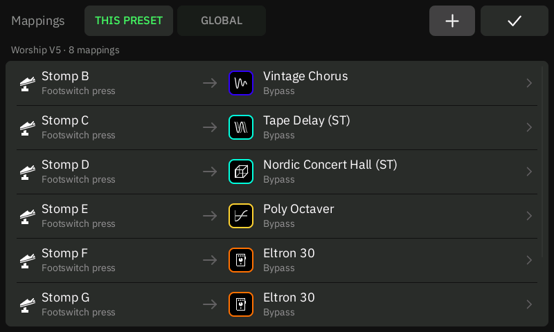
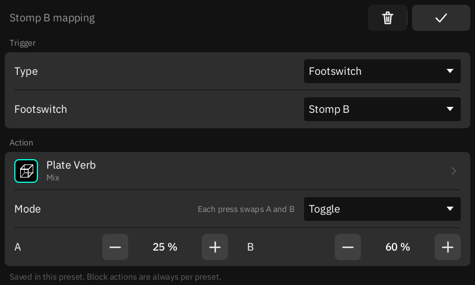
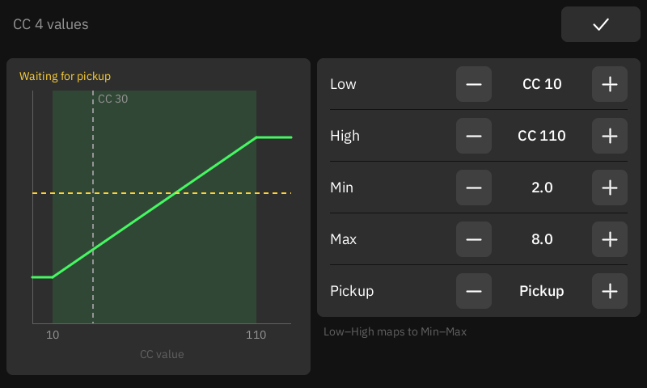

# Mappings

Mappings is one page for everything that a footswitch, a pedal, a MIDI message or an extension
does on your Quad Cortex. Open it from the Grid: **⋮ → Mappings**. In Tetrad it replaces the
stock **Preset MIDI Out** item.

  

Each row is one mapping: a **trigger** on the left and an **action** on the right.

## This preset and Global

The page has two tabs:

| Tab | Saved in | Triggers | Actions |
| --- | --- | --- | --- |
| **THIS PRESET** | The loaded preset | Preset loaded, footswitches A–H, EXP 1 and 2, MIDI, extension triggers | System, blocks, Send MIDI |
| **GLOBAL** | The unit (`/media/p4/tetrad/mappings.json`) | MIDI, extension triggers | System |

- Block actions are always saved in the preset, because each preset has its own blocks.
- When a preset mapping and a global mapping have the same trigger, only the preset mapping runs.
- A preset mapping is part of the preset. Save the preset to keep it, as for any other edit.
  Global mappings are saved at once.

## Add or change a mapping

1. Tap **+**, or tap a row.
2. Choose the **Type** of the trigger and its details (a footswitch letter, a pedal, a MIDI
   message or an extension source). For MIDI and extension triggers, tap **LEARN** and send the
   message: the next free message becomes the trigger.
3. Tap the **Action** row. The action menu has three parts:
   - **SYSTEM**: next or previous preset, a scene (or next/previous scene), the tuner, tap
     tempo, a footswitch mode, Gig View, and the Looper buttons.
   - **BLOCKS** (This preset only): a block of the preset, then its bypass or one of its
     parameters.
   - **MIDI OUT** (This preset only): Send MIDI. Tap **Edit messages** to set the messages in
     the stock message editor.
4. Choose the **Mode** (see below) and set its values.
5. Tap ✓. To delete the mapping, tap the trash button.

  

## Modes

The **Mode** says what the trigger's value does to the action. The menu shows only the modes
that fit the trigger and the action. A new mapping starts in the first one.

| Mode | Block parameter | Bypass, tuner, Gig View |
| --- | --- | --- |
| **Set** | Each press sets the value. | Each press switches on, or off (choose which). |
| **Toggle** | Each press swaps between A and B. | Each press switches on and off. |
| **Momentary** | Held: the value. Released: the value from before the press. | Switched while held. |
| **Step** | Each press moves the value by an amount (negative goes down). At the ends it stops or wraps. | |
| **Follow** | The CC sets the value: its window (Low…High) maps to Min…Max. Min above Max inverts. | On while the CC is in its window. |
| **Relative** | An endless encoder steps the value. Choose how it codes its steps: two's complement (1 up, 127 down), offset 64 (65 up, 63 down) or sign bit (1 up, 65 down). | |

- Values show in the parameter's own units ("12.0 dB", "Plate"). The − and + buttons move by
  the parameter's own step.
- Follow and Relative are for CC triggers. Footswitches, notes and extension presses use Set,
  Toggle, Momentary and Step. Preset loaded uses Set, or Toggle for bypass, tuner and Gig View.
- A footswitch releases when you lift it and a note releases on its note-off. Extensions say
  when a press ends (MIDI Mapper 0.3.0 and later does).
- **On press** runs an action once on each press: scene, preset, mode and tap tempo actions
  always, a Looper button as a tap. A Looper button can also be **Momentary** (held while you
  hold).
- An EXP pedal on a block is the stock expression link: set its range and switch in the block's
  ⋮ menu.

## CC window and Values page

Each CC mapping (QC channel or an extension CC) has a **window**: Low and High, 0–127.

- In Set, Toggle, Momentary, Step and On press, the CC **presses when it enters the window**
  and releases when it leaves. The default window is 64–127. A higher Low is a higher
  threshold; a window of 0–20 presses on low values.
- The same value twice in a row is a new press. So a button that sends only 127 works, and a
  knob that moves inside the window presses only once.
- In Follow, Low…High maps to Min…Max, and values outside the window stay at the nearer end.
  CC 0–64 → 0–100 % does the whole range on half of the pedal travel.
- To map CC values to exact values, add one row for each value on the same CC, each in Set
  with its own window. For example, a 3-way switch that sends 0, 64 or 127 can choose the
  reverb type with windows 0–42, 43–85 and 86–127.

With more than two values, the Values row opens the **Values page**. Its graph shows the window,
the map and the last value that the CC sent.

  

**Pickup** (Follow only): the parameter waits until the knob reaches its value, then follows.
Without it (**Jump**), the first move of the knob sets the value at once. After a preset load,
a scene change or a touch edit, the knob waits again.

## Stock data shows as mappings

Some rows are stock preset data. Tetrad shows them in the list and edits the stock data, so
stock CorOS still reads them:

- **Footswitch → block bypass** is the preset's Stomp-mode assignment. Its Toggle or Momentary
  mode is the footswitch's stock momentary setting, for every block on that footswitch. Set is
  not stock: it makes the row a Tetrad mapping.
- **EXP 1 or 2 → block** is the block's expression link.
- **Preset loaded, footswitch or EXP → Send MIDI** is the preset's Preset MIDI Out list.

Every other mapping is Tetrad data. In a preset it is kept in one extra field that stock CorOS
ignores and keeps when it saves the preset.

## MIDI

- MIDI triggers on the **QC's own MIDI channel** (Settings → Device → MIDI) can use any CC or
  note that the stock MIDI map does not use. The stock map keeps CC 0–2, 32, 35–62, 64, 120,
  123 and program changes; Tetrad refuses those for a mapping.
- To use **another MIDI channel**, install the MIDI Mapper extension (see
  [extensions.md](extensions.md)). It reserves its channel and offers it as a trigger type.

## Not built yet

- Load a chosen preset and set the tempo to a value.
- Send MIDI from a MIDI trigger or from a global mapping.
- System actions from an expression pedal.
