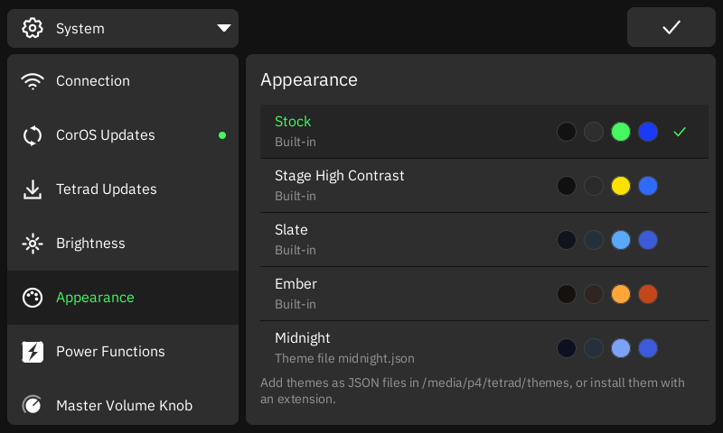
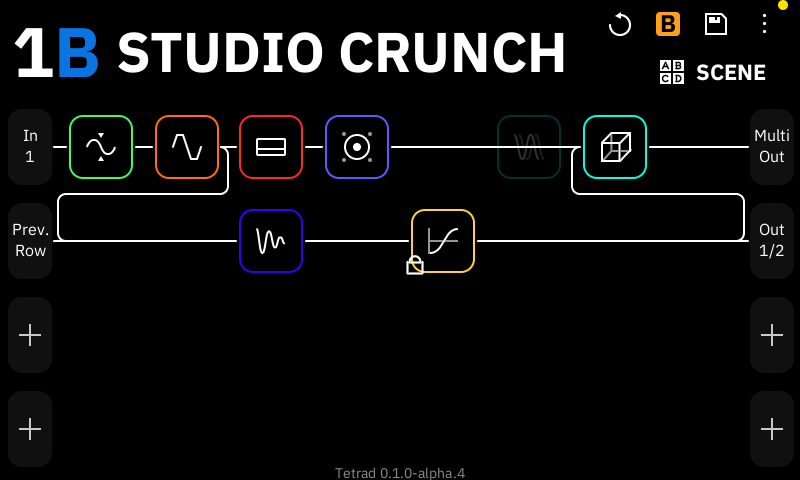
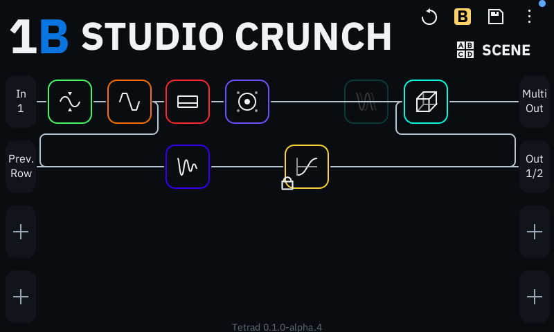
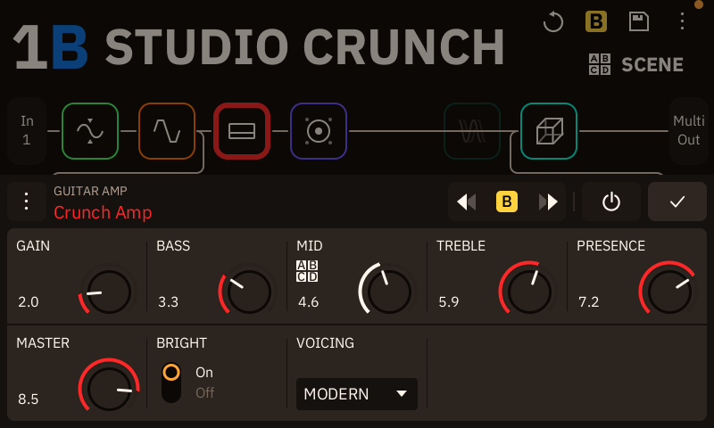

# Themes

A theme sets the colours of the Tetrad UI. Choose one in Settings → System → Appearance. The
change shows at once, and Tetrad keeps it across restarts.

Tetrad comes with four themes:

| Theme | Look |
|---|---|
| Stock | The stock CorOS colours. This is the default. |
| Stage High Contrast | Black, white and yellow, for bright stages. |
| Slate | Cool blue-grey with a blue accent. |
| Ember | Warm brown-grey with an orange accent. |

<table>
  <tr>
    <td width="50%"><br>Settings → Appearance.</td>
    <td width="50%"><br>Stage High Contrast.</td>
  </tr>
  <tr>
    <td width="50%"><br>Slate.</td>
    <td width="50%"><br>Ember. The amp keeps its red block colour.</td>
  </tr>
</table>

You can add more themes in two ways: as a theme file, or with an extension.

A theme changes only the colours of the UI itself. These colours stay the same in every theme:

- block colours
- scene colours, and the ink on them (Gig View tiles)
- footswitch LEDs
- the tuner's in-tune green

The boot menu and Recovery always use Stock, so a bad theme cannot make them hard to read.

## What a theme can set

A theme sets some or all of the 18 colours below. Write each colour as `#rrggbb`.

| Name | Where it shows |
|---|---|
| `background` | Page background, dropdown fields, black buttons |
| `canvas` | Grid, tuner and tempo background; block tiles; menus |
| `panel` | Cards, lists and parameter panels |
| `surface` | Selected menu rows, top-bar buttons, unselected tabs |
| `rowSelected` | Selected preset row; knob track |
| `section` | Section bars and grey buttons |
| `divider` | Lines between rows on cards |
| `scrollbar` | Scroll bar |
| `text` | Main text |
| `muted` | Secondary text: titles, units |
| `faint` | Unselected and disabled text |
| `cable` | Grid cables |
| `accent` | Selected items, switches, knob arcs, meters |
| `accentFill` | Fill under a selected tab |
| `onAccent` | Text on accent and warning fills |
| `action` | Main action buttons (Save, START CAPTURE) |
| `danger` | Record, mute and errors |
| `warning` | Scene badges and "New" badges |

A theme can leave colours out. Each missing colour comes from the `base` theme (Stock if you
give no `base`). Three missing colours follow other colours instead of the base:

- `divider` follows `background`.
- `accentFill` is a dark mix of `accent` into `background`, the same mix Stock uses.
- `onAccent` is black or white, whichever is easier to read on `accent`.

Some screens use extra shades that are not in this list, such as the darker grey of an idle
tab. Tetrad makes those shades from your colours.

## Rules

Tetrad checks each theme before it shows in Appearance. A theme that fails stays in the list,
with the reason, but you cannot choose it.

- **Dark only.** `background` and `canvas` must be dark (relative luminance under 0.18). The
  block icons are made for a dark background.
- **Readable.** Tetrad measures contrast as the screen shows the colours (16-bit colour).
  Each text colour must be readable on every fill it can sit on: `background`, `canvas`,
  `panel`, `surface`, `rowSelected`, `section` and `accentFill`.
  - `text`: at least 7:1 on `background`, `canvas` and `panel`, and 4.5:1 on the other fills
    and on `action`.
  - `muted`: at least 4.5:1 on `background` and 3:1 on the other fills.
  - `accent`: at least 4.5:1 on every fill except `section` (3:1).
  - `danger`: at least 4.5:1 on `background`.
  - `onAccent`: at least 4.5:1 on `accent`, `warning`, `muted`, `text` and `danger`, the bright
    fills it is drawn on.
- **Id.** 1 to 32 characters of `a-z`, `0-9` and `-`. It must not start with `-`.
- **Name.** 1 to 24 characters.

## Theme files

Put one theme in each `.json` file in `/media/p4/tetrad/themes/`. Copy the files with the
Cortex Control file browser, or over SSH. Tetrad reads the folder at start-up and each time you
open Appearance. It reads at most 32 files, each up to 64 KiB.

```json
{
  "version": 1,
  "id": "midnight",
  "name": "Midnight",
  "base": "slate",
  "colors": {
    "background": "#0d1020",
    "accent": "#7aa2f7"
  }
}
```

## Themes in extensions

An extension can add up to 8 themes in its manifest. To find out how, see
[Ship themes](extensions.md#ship-themes).

## How Tetrad keeps your choice

Tetrad saves your choice in `/media/p4/tetrad/appearance.json`, with the colours of the chosen
theme. When Tetrad starts, it shows those colours from the first frame, before it reads the
extensions.

If the chosen theme is no longer there (you deleted its file, or disabled its extension),
Tetrad shows Stock. The choice stays saved, so the theme comes back when its file or
extension comes back.
